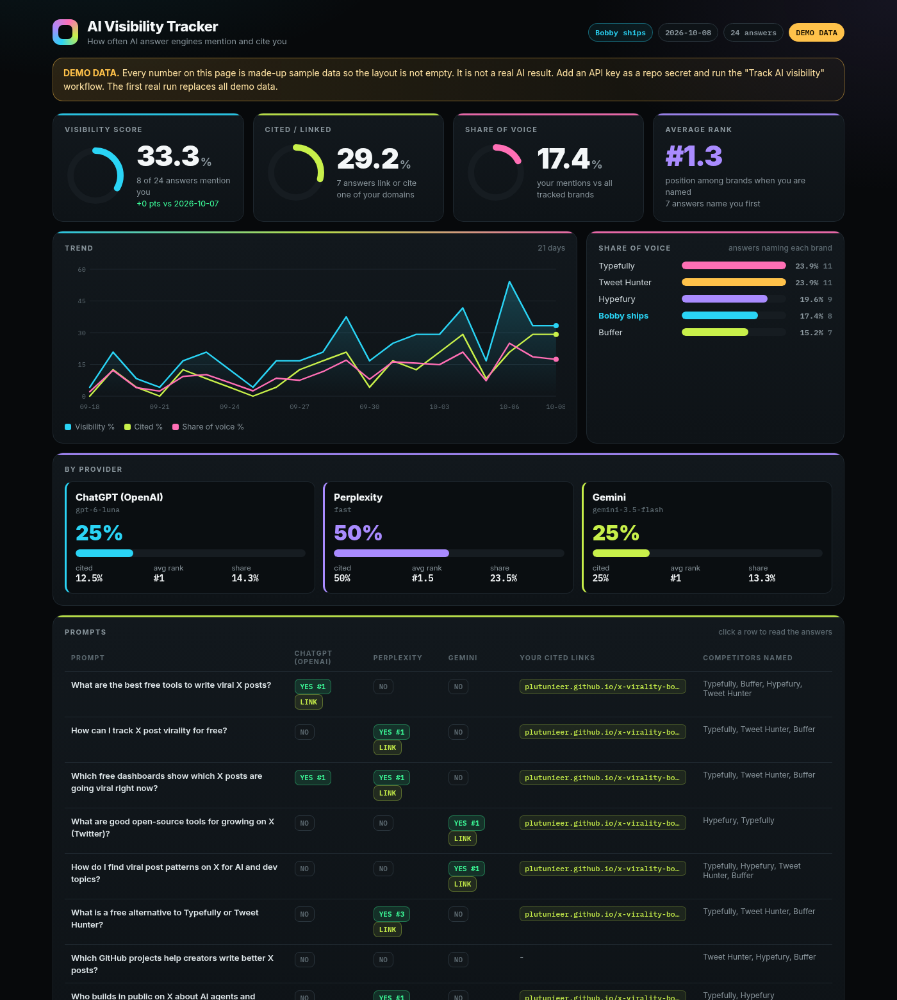

# AI Visibility Tracker

Track how often AI answer engines (ChatGPT / OpenAI, Perplexity, Gemini) **mention, rank and cite** your brand, handle or website, compared with your competitors. Every day, automatically, for free or a few cents.

**Live dashboard:** https://plutunieer.github.io/ai-visibility/



> The dashboard ships with **DEMO data** (marked `"demo": true` and shown with a yellow DEMO banner) so the page is not empty. These numbers are invented sample data, not real AI results. The first real run replaces them.

## What it does

1. Reads `config.json`: your brand name, aliases (e.g. `@handle`), domains, competitors and a fixed list of prompts.
2. Sends every prompt to every AI provider that has an API key (with web search turned on where the API supports it).
3. Checks every answer:
   - **Mentioned**: does the answer name your brand, alias or domain?
   - **Rank**: if it does, at which position among all tracked brands (you + competitors)?
   - **Cited**: does it link to or use one of your domains as a source?
   - **Competitors**: which competitors are named?
4. Computes the daily scores:
   - **Visibility score** = % of answers that mention you
   - **Citation rate** = % of answers that link/cite your domains
   - **Share of voice** = your mentions / mentions of all tracked brands
   - **Average rank** when you are mentioned
5. Writes `data/latest.json` (full answers + per-prompt results) and appends one row per day to `data/history.json`.
6. `index.html` (plain static page, no build step) shows everything: score tiles, share of voice, per-provider breakdown, per-prompt table with cited links, trend chart.

## The method

This is the same core method the paid tools (Profound, Peec AI, Otterly, Semrush AI Toolkit) use: run a fixed prompt list against AI models on a schedule, then count mentions, positions and citations for your brand vs competitors. There is no official "AI visibility" data from OpenAI, Google or Perplexity, so everyone measures it this way. Paid tools add more models, countries and pretty reports; the measurement itself is this.

## Setup in 3 steps

> **One-time: switch on the daily workflow.** The workflow file lives in [`setup/track.yml`](setup/track.yml) and must be copied to `.github/workflows/track.yml` once (the tool that created this repo was not allowed to write workflow files).
> One click: **[add the workflow](https://github.com/plutunieer/ai-visibility/new/main?filename=.github/workflows/track.yml&value=name%3A%20Track%20AI%20visibility%0A%0Aon%3A%0A%20%20schedule%3A%0A%20%20%20%20-%20cron%3A%20%2217%206%20%2A%20%2A%20%2A%22%20%20%20%23%20every%20day%2006%3A17%20UTC%0A%20%20workflow_dispatch%3A%20%7B%7D%0A%0Apermissions%3A%0A%20%20contents%3A%20write%0A%0Aconcurrency%3A%0A%20%20group%3A%20track%0A%20%20cancel-in-progress%3A%20false%0A%0Ajobs%3A%0A%20%20track%3A%0A%20%20%20%20runs-on%3A%20ubuntu-latest%0A%20%20%20%20timeout-minutes%3A%2030%0A%20%20%20%20steps%3A%0A%20%20%20%20%20%20-%20uses%3A%20actions/checkout%40v4%0A%0A%20%20%20%20%20%20-%20uses%3A%20actions/setup-python%40v5%0A%20%20%20%20%20%20%20%20with%3A%0A%20%20%20%20%20%20%20%20%20%20python-version%3A%20%223.12%22%0A%0A%20%20%20%20%20%20-%20name%3A%20Run%20tracker%20%28skips%20providers%20without%20a%20key%29%0A%20%20%20%20%20%20%20%20env%3A%0A%20%20%20%20%20%20%20%20%20%20OPENAI_API_KEY%3A%20%24%7B%7B%20secrets.OPENAI_API_KEY%20%7D%7D%0A%20%20%20%20%20%20%20%20%20%20PERPLEXITY_API_KEY%3A%20%24%7B%7B%20secrets.PERPLEXITY_API_KEY%20%7D%7D%0A%20%20%20%20%20%20%20%20%20%20GEMINI_API_KEY%3A%20%24%7B%7B%20secrets.GEMINI_API_KEY%20%7D%7D%0A%20%20%20%20%20%20%20%20run%3A%20python%20track.py%0A%0A%20%20%20%20%20%20-%20name%3A%20Commit%20new%20data%0A%20%20%20%20%20%20%20%20run%3A%20%7C%0A%20%20%20%20%20%20%20%20%20%20git%20config%20user.name%20%22github-actions%5Bbot%5D%22%0A%20%20%20%20%20%20%20%20%20%20git%20config%20user.email%20%2241898282%2Bgithub-actions%5Bbot%5D%40users.noreply.github.com%22%0A%20%20%20%20%20%20%20%20%20%20git%20add%20data/%0A%20%20%20%20%20%20%20%20%20%20if%20git%20diff%20--cached%20--quiet%3B%20then%0A%20%20%20%20%20%20%20%20%20%20%20%20echo%20%22No%20new%20data%20%28no%20API%20keys%20set%20or%20nothing%20changed%29.%22%0A%20%20%20%20%20%20%20%20%20%20%20%20exit%200%0A%20%20%20%20%20%20%20%20%20%20fi%0A%20%20%20%20%20%20%20%20%20%20git%20commit%20-m%20%22data%3A%20AI%20visibility%20%24%28date%20-u%20%2B%25F%29%22%0A%20%20%20%20%20%20%20%20%20%20git%20push%0A)**, then press *Commit changes*. Or locally: `mkdir -p .github/workflows && cp setup/track.yml .github/workflows/ && git add .github && git commit -m "enable workflow" && git push`.

1. **Get the repo**: fork it, or click "Use this template" / copy the files into your own repo. Turn on GitHub Pages: *Settings → Pages → Deploy from a branch → `main` / root*.
2. **Add API keys as secrets**: *Settings → Secrets and variables → Actions → New repository secret*. Add any of these (one is enough; providers without a key are skipped):

   | Secret name | Provider | Where to get it |
   |---|---|---|
   | `OPENAI_API_KEY` | OpenAI (Responses API + web search) | https://platform.openai.com/api-keys |
   | `PERPLEXITY_API_KEY` | Perplexity (Agent API, `fast` preset, Sonar fallback) | https://www.perplexity.ai/settings/api |
   | `GEMINI_API_KEY` | Google Gemini (Google Search grounding) | https://aistudio.google.com/apikey |

3. **Edit `config.json`** (brand, aliases, domains, competitors, prompts), then run the workflow: *Actions → Track AI visibility → Run workflow*. After that it runs by itself every day at 06:17 UTC and commits the new data. The dashboard updates a minute later.

Run it locally:

```bash
export OPENAI_API_KEY=sk-...        # any subset of the three keys
python3 track.py                    # real run, writes data/
python3 track.py --demo             # regenerate DEMO sample data
python3 -m http.server 8000         # open http://localhost:8000
```

No dependencies: Python 3.9+ standard library only.

## config.json

```json
{
  "brand": { "name": "Bobby ships", "aliases": ["@bobbyships"], "domains": ["plutunieer.github.io", "github.com/plutunieer"] },
  "competitors": [ { "name": "Typefully", "aliases": ["typefully.com"] } ],
  "prompts": [ "What are the best free tools to write viral X posts?" ],
  "providers": {
    "openai":     { "enabled": true, "model": "gpt-6-luna", "web_search": true },
    "perplexity": { "enabled": true, "preset": "fast" },
    "gemini":     { "enabled": true, "model": "gemini-3.5-flash", "google_search": true }
  }
}
```

Tips: write prompts the way real users ask (problem-first, not with your brand name in them). 8 to 20 prompts is plenty. Keep the list stable so days are comparable.

## Cost

With 8 prompts and 3 providers that is 24 API calls per day. With small models this is roughly **a few cents per day** (most of it is the per-search fee of web search tools; Gemini has a free tier). Check your provider's current pricing; you can switch models in `config.json` or disable a provider.

## Limitations

- API answers differ slightly from what people see in the ChatGPT, Perplexity or Gemini apps (different system prompts, personalization, location, model versions). Treat the numbers as a **trend**, not as exact truth.
- AI answers are random: the same prompt can give a different answer tomorrow. Look at weekly direction, not single days.
- Brand detection is text matching on your name, aliases and domains. Pick distinctive aliases; generic words cause false positives.
- Gemini returns redirect links for sources; the real domain is read from the source title.
- Google AI Overviews has no official API and is not included.

## Files

| File | Purpose |
|---|---|
| `config.json` | what to track |
| `track.py` | the tracker (stdlib only) |
| `data/latest.json` | latest run, every answer |
| `data/history.json` | one row per day for the trend |
| `index.html` | dashboard (GitHub Pages) |
| `setup/track.yml` | daily cron + manual run (copy to `.github/workflows/track.yml`) |

---

## Schnellstart (Deutsch)

0. **Einmalig den Workflow einschalten:** [diesen Link öffnen](https://github.com/plutunieer/ai-visibility/new/main?filename=.github/workflows/track.yml&value=name%3A%20Track%20AI%20visibility%0A%0Aon%3A%0A%20%20schedule%3A%0A%20%20%20%20-%20cron%3A%20%2217%206%20%2A%20%2A%20%2A%22%20%20%20%23%20every%20day%2006%3A17%20UTC%0A%20%20workflow_dispatch%3A%20%7B%7D%0A%0Apermissions%3A%0A%20%20contents%3A%20write%0A%0Aconcurrency%3A%0A%20%20group%3A%20track%0A%20%20cancel-in-progress%3A%20false%0A%0Ajobs%3A%0A%20%20track%3A%0A%20%20%20%20runs-on%3A%20ubuntu-latest%0A%20%20%20%20timeout-minutes%3A%2030%0A%20%20%20%20steps%3A%0A%20%20%20%20%20%20-%20uses%3A%20actions/checkout%40v4%0A%0A%20%20%20%20%20%20-%20uses%3A%20actions/setup-python%40v5%0A%20%20%20%20%20%20%20%20with%3A%0A%20%20%20%20%20%20%20%20%20%20python-version%3A%20%223.12%22%0A%0A%20%20%20%20%20%20-%20name%3A%20Run%20tracker%20%28skips%20providers%20without%20a%20key%29%0A%20%20%20%20%20%20%20%20env%3A%0A%20%20%20%20%20%20%20%20%20%20OPENAI_API_KEY%3A%20%24%7B%7B%20secrets.OPENAI_API_KEY%20%7D%7D%0A%20%20%20%20%20%20%20%20%20%20PERPLEXITY_API_KEY%3A%20%24%7B%7B%20secrets.PERPLEXITY_API_KEY%20%7D%7D%0A%20%20%20%20%20%20%20%20%20%20GEMINI_API_KEY%3A%20%24%7B%7B%20secrets.GEMINI_API_KEY%20%7D%7D%0A%20%20%20%20%20%20%20%20run%3A%20python%20track.py%0A%0A%20%20%20%20%20%20-%20name%3A%20Commit%20new%20data%0A%20%20%20%20%20%20%20%20run%3A%20%7C%0A%20%20%20%20%20%20%20%20%20%20git%20config%20user.name%20%22github-actions%5Bbot%5D%22%0A%20%20%20%20%20%20%20%20%20%20git%20config%20user.email%20%2241898282%2Bgithub-actions%5Bbot%5D%40users.noreply.github.com%22%0A%20%20%20%20%20%20%20%20%20%20git%20add%20data/%0A%20%20%20%20%20%20%20%20%20%20if%20git%20diff%20--cached%20--quiet%3B%20then%0A%20%20%20%20%20%20%20%20%20%20%20%20echo%20%22No%20new%20data%20%28no%20API%20keys%20set%20or%20nothing%20changed%29.%22%0A%20%20%20%20%20%20%20%20%20%20%20%20exit%200%0A%20%20%20%20%20%20%20%20%20%20fi%0A%20%20%20%20%20%20%20%20%20%20git%20commit%20-m%20%22data%3A%20AI%20visibility%20%24%28date%20-u%20%2B%25F%29%22%0A%20%20%20%20%20%20%20%20%20%20git%20push%0A) und *Commit changes* klicken. Das kopiert `setup/track.yml` nach `.github/workflows/track.yml`.
1. **Repo forken** (oder Dateien kopieren) und unter *Settings → Pages* "Deploy from a branch", `main`, Ordner `/ (root)` einstellen.
2. **API-Keys als Secrets anlegen** unter *Settings → Secrets and variables → Actions*: `OPENAI_API_KEY`, `PERPLEXITY_API_KEY` und/oder `GEMINI_API_KEY`. Einer reicht, fehlende werden übersprungen.
3. **`config.json` anpassen** (Marke, Aliase wie `@handle`, Domains, Konkurrenten, Fragen) und unter *Actions → Track AI visibility → Run workflow* starten. Danach läuft es jeden Tag automatisch.

Bis zum ersten echten Lauf zeigt das Dashboard **DEMO-Daten** (gelber Hinweis). Der erste echte Lauf ersetzt sie. Kosten: ein paar Cent pro Tag. Die API-Antworten weichen etwas von den Apps ab, also auf den Trend schauen, nicht auf einzelne Tage.
